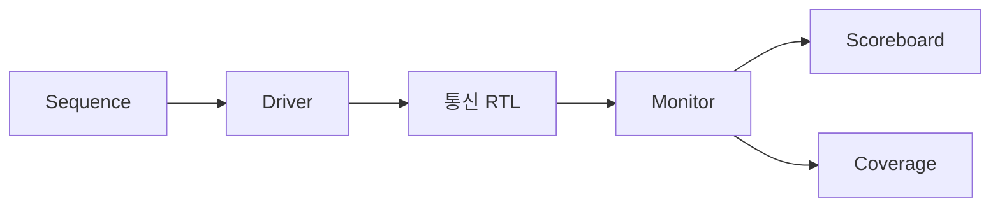

# SPI 및 I2C 검증 구성

## SPI

`spi/rtl/`에는 Master, Slave, 통합 모듈이 있습니다. `spi/tb/`는 Sequence Item·Sequence·Driver·Monitor·Scoreboard·Coverage로 역할을 나눕니다. Scoreboard는 Master 송신과 Slave 수신, 반대 방향의 데이터를 비교합니다. Directed와 Random 시나리오를 함께 적용합니다.

## I2C

`i2c/rtl/`에는 Master 및 시계 응답용 Slave 관련 모듈이 있습니다. 테스트벤치는 주소·읽기/쓰기·데이터·ACK를 관측합니다. SDA 변경 시점을 분리하여 시뮬레이션 레이스를 다룬 구조를 포함합니다.

## 디버깅 사례

에지 검출 식의 선언 시 초기화와 연속 할당 차이, 외부 신호 동기화 지연, I2C SDA 변경 시점, 커버리지에서 빠진 경계값 조합을 분석했습니다. 자세한 기존 결과는 `docs/completion-report.docx`를 확인하세요.

## 결과 해석

README에는 원본의 시퀀스 요청 수와 Scoreboard 집계 수를 같은 수치로 합치지 않았습니다. 커버리지 100%는 정의된 기능 Bin의 달성률입니다. 재실행 시 테스트 이름·시드·비교 횟수·오류 수·커버리지 리포트를 함께 기록해야 합니다.
